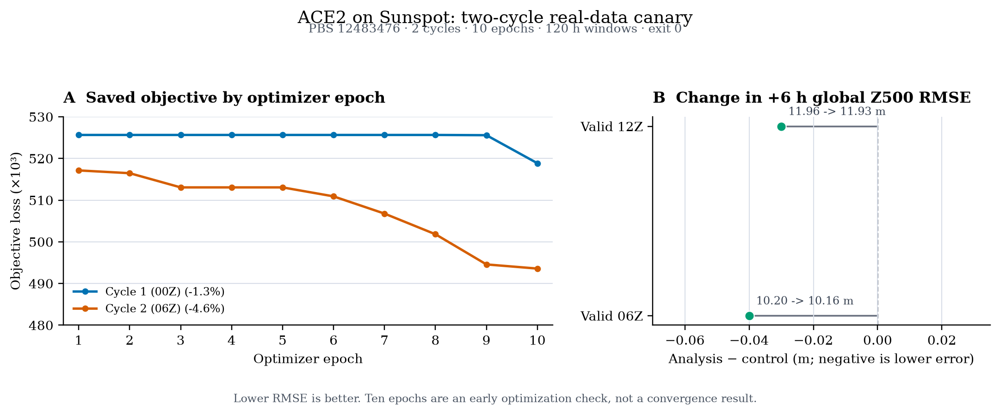
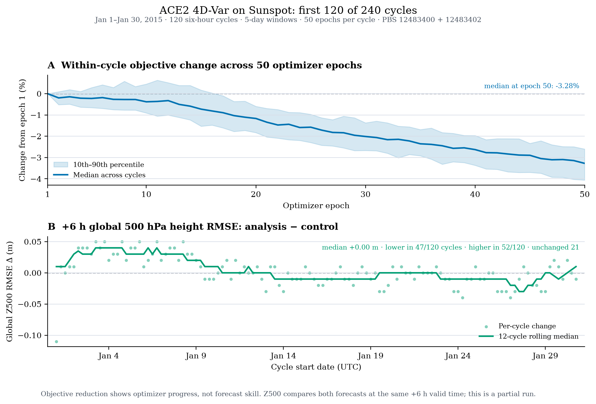

# `lw4dvar-torch` ALCF status

## Code

- Fork: [`saforem2/lw4dvar-torch`](https://github.com/saforem2/lw4dvar-torch)
- Branch: [`feature/ezpz-device-agnostic`](https://github.com/saforem2/lw4dvar-torch/tree/feature/ezpz-device-agnostic)
- The original Sunspot-tested device changes are at [`ddcc279`](https://github.com/saforem2/lw4dvar-torch/commit/ddcc279bf803803a991ff4deaeddab1a7c39a027). SHA-256 checks of all 50 changed paths matched the tested Sunspot tree.
- No pull request has been opened for `lw4dvar-torch`.

The device resolver uses `ezpz`, backend defaults use `auto`, and CUDA-specific tuning remains behind device checks. The test and run commands are in [`ALCF_QUICKSTART.md`](ALCF_QUICKSTART.md).

## Shared ALCF instructions

The clone, setup, dependency install, and mini-case command are the same on Aurora, Sunspot, Polaris, and Sirius. `ezpz_setup_env` selects the site stack. `uv pip install --no-deps` keeps that PyTorch build in place.

Run `ezpz launch` inside a compute allocation. It launches the workload; it does not request nodes. From a login node, use an interactive allocation or `ezpz submit`; PBS queue, account, and filesystem values depend on the system and project.

Sirius needs [ezpz PR #297](https://github.com/saforem2/ezpz/pull/297) merged for the standard setup to select the site-matched CUDA 13 stack. The successful Sirius run used `conda/2026-10-09`.

## Hardware results

| System | Hardware | Result | Evidence |
|---|---|---|---|
| Sunspot | Intel XPU | Generic XPU autograd, mini ACE2 4D-Var, and full 1° ACE2 checkpoint forecast/gradient smokes passed. | PBS jobs `12483304`, `12483386`, `12483387` |
| Sirius | 4× A100, CUDA 13.0 | CUDA forward/backward smoke and mini ACE2 solver test passed. | PBS jobs `33440`, `33446` |
| Polaris | 4× A100, CUDA 12.8 | CUDA forward/backward smoke passed. Mini ACE2 solver test has not run; the per-user queue limit blocked submission. | PBS job `7838743` |
| Aurora | Intel XPU | Not validated in this effort. | — |

The Sunspot full-checkpoint smoke used the released 1° ACE2-ERA5 model and its matching 2020 initial condition and forcing. The 240-cycle ACE2 4D-Var experiment has completed its first 120 cycles; the continuation is running on Sunspot. It is not yet a completed-run result.

## Tests and model coverage

- The checked-in `test_scripts/run_sunspot_validation.sh` ran as PBS job `12483373` at commit `791c29a238285f6c0debf730c65cae5a7043b224` on `x1921c0s6b0n0`: Ruff passed; `102 passed` in 16.12 s; mini ACE2 solver `1 passed` in 117.75 s; XPU forward/backward passed with finite loss and gradient. PBS reported `job_state = F`, `Exit_status = 0`, walltime `00:02:33`.
- The updated checked-in recipe ran as PBS job `12483394` on `x1922c5s6b0n0`: Ruff passed; `102` unit tests passed in 26.59 s; mini ACE2 with automatic selection passed in 39.73 s; the standalone smoke reported `device=xpu`, finite loss `0.491877`, and gradient norm `0.176259`. PBS reported `job_state = F`, `Exit_status = 0`, walltime `00:01:29`.
- Sunspot PBS job `12483369`, branch commit `bae663c3c8b77f09d58444ec7ed32cbfa938ad13`, ran on compute node `x1921c0s6b0n0` with the ALCF Python 3.12.12 / PyTorch `2.13.0a0+gitcf30153` environment: Ruff passed; `102 passed` in 34.43 s; mini ACE2 solver `1 passed` in 119.54 s; XPU forward/backward passed with finite loss and gradient. PBS reported `job_state = F`, `Exit_status = 0`, walltime `00:03:50`.
- Historical Sunspot job `12483370` exposed that installed `fme 2026.5.1` selected CPU while the project selected XPU. `backends/ace2/ace2_model.py` now adapts FME's imported selector aliases when ACE2 explicitly resolves to XPU, while honoring `FME_FORCE_CPU=1`. The mini 4D-Var test and full released-checkpoint smoke now pass on XPU.
- The tracked configs cover AIFS 1.1/2.0/3, FCN3, ACE2, SFNO, Aurora, GraphCast, and NGCM. ACE2 is the only backend with a checkpoint-backed forward/solver run in this validation; other backends still have config and shared-grid coverage, not forward runs.

Other model configs still point at external checkpoints and caches, so additional backend runs need those assets staged in readable storage. The test-suite result above is from ALCF compute nodes; the earlier macOS run is not accelerator validation.

## Short real-data ACE2 canary

`config_ace2_2cycle_10it.yml` is a reduced multi-cycle run that keeps the same
ACE2 checkpoint, 120-hour window, real surface-pressure observations, and
six-hour cycling as the full run, but runs two cycles for 10 optimizer epochs
each. Sunspot PBS job `12483476` completed on `x1922c5s3b0n0` with
`Exit_status = 0` in 3:50. Its stdout log,
`lw4dvar-ace2-2x10-serial.o12483476`, ends with `...JOB COMPLETED...`. It
wrote 20 NetCDF/Pickle/diagnostic artifacts (about 1.3 GB) under
`output/test_ace2_2cycle_10it_sunspot/`.

Each cycle optimizes ACE2's starting state so its five-day trajectory fits the
surface-pressure observations better. The first cycle starts at
`2015-01-01T00`; the analysis is advanced six hours and the second cycle starts
at `2015-01-01T06`. Ten optimizer epochs run per cycle, instead of 50 in the full config.
The objective combines the assimilation costs; it is not a forecast-error
score, and its absolute value differs by cycle because each cycle has different
states and observations.

At +6 hours the global Z500 RMS error changed from `10.20 m` to `10.16 m`; at
+12 hours it changed from `11.96 m` to `11.93 m`. The logged loss moved from
`525647.8` to `518862.4` for cycle 1 and from `517137.2` to `493581.7` for
cycle 2. These 10-epoch cycles are a quick hardware and pipeline check, not a
converged substitute for the 50-epoch full experiment.

Panel A shows each cycle's objective change from its own epoch-1 value; compare
the within-cycle slopes, not the absolute objective between cycles. Panel B
compares global 500 hPa height RMSE at each cycle's +6-hour verification time,
before and after assimilation. The changes are `-0.04 m` and `-0.03 m`; this
two-cycle canary does not establish a useful forecast improvement.



Figure source: [`plot_ace2_sunspot_canary.py`](../figures/plot_ace2_sunspot_canary.py)
and [SVG](../figures/ace2_sunspot_2cycle_10it.svg). The script reads the original
loss files and stdout log on Sunspot. Rebuild from the repository root with:

```bash
uv run --no-project --with matplotlib python figures/plot_ace2_sunspot_canary.py \
  --output-dir output/test_ace2_2cycle_10it_sunspot \
  --job-log lw4dvar-ace2-2x10-serial.o12483476
```
The run config is [`config_ace2_2cycle_10it.yml`](../config_ace2_2cycle_10it.yml);
its SHA-256 is `3355e009785267def6dc3cb77d014c725d2919015a6f6c15a037b91735f22c40`.

## Run evidence

Each completed successful PBS job ended with `job_state = F` and `Exit_status = 0`. The ACE2/XPU attempt above ended with `Exit_status = 1` for the documented FME device mismatch.

| Job | System / node | Wall time | Output | Tested code |
|---|---|---:|---|---|
| `12483304` | Sunspot / `x1922c4s3b0n0` | `00:00:17` | `device=xpu torch=2.13.0.dev20260519+xpu loss=0.491877 grad_norm=0.176259` | `ddcc279` |
| `12483310` | Sunspot / `x1922c5s6b0n0` | `00:02:48` | `1 passed in 156.04s (0:02:36)` | `ddcc279` |
| `33440.sirius-pbs-0001.hsn.cm.sirius.alcf.anl.gov` | Sirius / `x3200c0s13b0n0` | `00:00:17` | `torch=2.14.0 cuda=13.0`, finite loss and gradient | `6a987e5` |
| `33446.sirius-pbs-0001.hsn.cm.sirius.alcf.anl.gov` | Sirius / `x3200c0s13b0n0` | `00:01:05` | `torch 2.14.0 cuda 13.0 cudnn 92600 available True`; `1 passed in 33.62s` | `29507ce` |
| `7838743.polaris-pbs-01.hsn.cm.polaris.alcf.anl.gov` | Polaris / `x3005c0s19b1n0` | `00:01:04` | `device=cuda torch=2.8.0+cu128 cuda=12.8`, finite loss and gradient | `6a987e5` |
| `12483369.sunspot-pbs-0001.head.cm.sunspot.alcf.anl.gov` | Sunspot / `x1921c0s6b0n0` | `00:03:50` | `102` unit tests; mini ACE2 solver pass; XPU forward/backward finite loss and gradient | `bae663c` |
| `12483370.sunspot-pbs-0001.head.cm.sunspot.alcf.anl.gov` | Sunspot / `x1921c0s6b0n0` | `00:00:29` | ACE2 with auto device stopped because FME chose CPU while resolver chose XPU | `bae663c` |
| `12483373.sunspot-pbs-0001.head.cm.sunspot.alcf.anl.gov` | Sunspot / `x1921c0s6b0n0` | `00:02:33` | Checked-in recipe at the time: `102` unit tests; mini ACE2 CPU solver pass; XPU forward/backward finite loss and gradient | `791c29a` |
| `12483386.sunspot-pbs-0001.head.cm.sunspot.alcf.anl.gov` | Sunspot / `x1922c5s4b0n0` | `00:00:46` | Mini ACE2 4D-Var on XPU; `1 passed in 40.42s`; PBS `Exit_status = 0` | `945d602` |
| `12483387.sunspot-pbs-0001.head.cm.sunspot.alcf.anl.gov` | Sunspot / `x1922c5s4b0n0` | `00:01:11` | Full 1° ACE2: 4-step forecast, finite latent gradient with and without checkpointing, AdamW loss reduction, 4/20-step timings; `ALL CHECKS PASSED`; PBS `Exit_status = 0` | `945d602` |
| `12483394.sunspot-pbs-0001.head.cm.sunspot.alcf.anl.gov` | Sunspot / `x1922c5s6b0n0` | `00:01:29` | Updated validation script: Ruff, `102` unit tests, mini ACE2 auto/XPU, XPU forward/backward; PBS `Exit_status = 0` | `945d602` |

The Sunspot mini solver job wrote `$HOME/lw4dvar-torch-sunspot-port/lw4dvar-mini-ace2.o12483310`; its checkpoint SHA-256 was `c3d6818df5478ea5efb53b72b38c371a8da7a90fb8aa7108a796b8edebab0fe3`. Sirius job `33446` ran the mini fixture with one 24-hour window and 50 epochs. It checked that the cost decreased and verified analysis and forecast outputs. The fixture is not the full ACE2 dataset.

## Checkpoint and project storage

The repository estimates each AIFS checkpoint at about `1 GB`, FCN3 at
`2.8 GB`, and the Aurora checkpoint at about `4.9 GB` plus a static-field
file. SFNO's NGC package is `6.9 GB` and converts to `2.1 GB` of weights. The
mini ACE2 fixture is `22 MB`; the released 1° ACE2 checkpoint is `1.7 GiB`,
the 2020 initial condition is `113 MiB`, and yearly forcing is about `524 MiB`.
Sunspot's `datascience` project quota has about `9 TB` available.

Logs remain on their respective systems:

- Sunspot XPU smoke: `$HOME/lw4dvar-xpu-final.o12483304`
- Sunspot mini ACE2 XPU: `/tegu/datascience/foremans/lw4dvar-torch/lw4dvar-ace2-xpu.o12483386`
- Sunspot full ACE2 XPU: `/tegu/datascience/foremans/lw4dvar-torch/lw4dvar-ace2-full-xpu.o12483387`
- Sunspot updated validation: `/tegu/datascience/foremans/lw4dvar-torch/lw4dvar-validation-xpu.o12483394`
- Sirius CUDA smoke: `$HOME/tmp/lw4dvar-torch-sirius-6a987e5/lw4dvar-sirius-smoke.o33440`
- Polaris CUDA smoke: `$HOME/tmp/lw4dvar-torch-polaris-6a987e5/lw4dvar-cuda-smoke.o7838743`
- New Sunspot validation logs: `/tegu/datascience/foremans/lw4dvar-validation-logs/` (`12483369`, `12483370`, `12483373`).

## Full ACE2 240-cycle run on Sunspot

Status snapshot: **2026-11-13 16:08 UTC**. The verified target is the
`datascience` checkout at `/tegu/datascience/foremans/lw4dvar-torch` on
`sunspot-uan-0001`.

Run code HEAD: `86326da931c0f54d93beabc6c8b746466439d5d4`.

- The `ic_cache_ace2/` cache contains 242 NetCDF files: the 2014-12-30 initial
  condition and 241 six-hourly verification states from 2015-01-01 00Z through
  2015-03-02 00Z. Total cache size is 138,335,341 bytes. Its checked-in
  `MANIFEST.sha256` file is present (SHA-256
  `6dd62bffcc923c5cd82471211532a6a30da0b0235f63688df7f16a7b402146b1`).
- Pilot job `12483400` (`lw4dvar-ace2-pilot`) finished on `x1921c0s5b0n0`
  with PBS `Exit_status = 0` in 8:13. It completed the first 2015-01-01 00Z
  cycle, a five-day window with 50 epochs and checkpoint stride 1.
- Chunk A job `12483402` (`lw4dvar-ace2-240a`) finished with PBS
  `Exit_status = 0` after 15:16:18. Its log ends with `...JOB COMPLETED...`
  and contains 119 completed cycles from `2015-01-01T06` through
  `2015-01-30T18`. With the pilot cycle, the first **120 of 240 cycles** are
  complete: 6,000 optimizer epochs in total. Outputs are under
  `output/test_ace2_240cycle_6h_5d_50it/` and
  `output/test_ace2_240cycle_pilot_retry/`.
- The original continuation job `12483405` (`lw4dvar-ace2-240b`) did not run.
  PBS put it on system hold after 21 failed start attempts (`too many failed
  attempts to run`); it has no application log or exit status.
- Continuation retry `12483657` was submitted with `ezpz submit` and the
  existing `afterok:12483402` dependency. PBS reports it running with a
  23-hour walltime request on `x1921c5s7b0n0`. It resumes from the
  `2015-01-30T18` analysis and advances to the next six-hour cycle,
  `2015-01-31T00`.
- The earlier stride-2 attempt failed with Intel XPU
  `UR_RESULT_ERROR_OUT_OF_RESOURCES`; the current run uses checkpoint stride
  1. The full experiment remains **in progress** until the retry finishes with
  zero exit status and all 240 cycle outputs are verified.

The retrieved PBS stdout logs match the on-Sunspot files by SHA-256:
pilot `6c3ed2cfadacf7919b4cdc1c4b9f831c53d31ff4e604aae19165463ef6f0114d`;
chunk A `673783e1488000fc0c2908c3874d94e397a03a72cdce5849bbcc1b48e029d41e`.

The pilot and chunk-A logs contain 120 complete 50-epoch optimization traces
and paired +6-hour global 500 hPa height RMSE checks. Median objective change
from epoch 1 to 50 was `-3.28%` per cycle. The median analysis-minus-control
RMSE change was `+0.00 m`: error was lower in 47 cycles, higher in 52, and
unchanged in 21. The optimizer reduced its own objective consistently, while
the short-lead forecast check did not show a consistent improvement.



The top panel shows each cycle's objective normalized to its own epoch-1 value;
the line is the median across cycles and the shaded band is the 10th–90th
percentile. The bottom panel shows the same-valid-time change in global Z500
RMSE at +6 h; negative values mean lower error after assimilation. This is a
partial-run diagnostic, not evidence that the full 240-cycle experiment has
finished or that forecast skill improved overall. The figure is generated by
[`plot_ace2_240cycle_partial.py`](../figures/plot_ace2_240cycle_partial.py)
from the two Sunspot stdout logs. No intermediate CSV is tracked.

Rebuild it from the repository root after fetching those logs from Sunspot:

```bash
ssh sunspot 'cat /tegu/datascience/foremans/lw4dvar-torch/lw4dvar-ace2-pilot.o12483400' > /tmp/lw4dvar-ace2-pilot.o12483400
ssh sunspot 'cat /tegu/datascience/foremans/lw4dvar-torch/lw4dvar-ace2-240a.o12483402' > /tmp/lw4dvar-ace2-240a.o12483402
uv run --no-project --with matplotlib python figures/plot_ace2_240cycle_partial.py \
  --job-logs /tmp/lw4dvar-ace2-pilot.o12483400 /tmp/lw4dvar-ace2-240a.o12483402
```

The old Polaris config points to `/lus/eagle/projects/moonshot-reanalysis/jwhitaker/psobs`; that path returns `Permission denied` for this account. The generic ACE2 config used to point to `/scratch3/NCEPDEV/da/Jeffrey.Whitaker/psobs`, which is not readable from Sunspot. It now reads `./psobs`; a Sunspot symlink points that relative path at the staged ISPD data.

A fresh public source is now staged on Sunspot under
`/tegu/datascience/foremans/lw4dvar-observations/ispdv4.7/`. It contains 260
six-hourly ISPD v4.7 HDF5 files for `2015-01-01T00` through
`2015-03-06T18` (948,348,457 bytes), plus 260 solver-format files in `psobs/`
with 2,644,377 type-181 surface-pressure observations. Conversion keeps finite
pressures from 0 to 2000 hPa and uses 1 hPa observation error, matching the
existing `psobs1` input convention. The Jan 15 00Z file has 9,968 observations;
the historical file had 10,821, so this public-source run is not an exact
reproduction of the old archive. The source dataset is [NCAR GDEX ISPD v4.7](https://gdex.ucar.edu/datasets/d132002/), DOI `10.5065/9EYR-TY90`.

The public ACE2 checkpoint and 2014/2015 forcing files are present in the
Sunspot submodule and match their LFS SHA-256 pointers. For the full-checkpoint
XPU smoke, the matching 2020 inputs were downloaded from the public
`allenai/ACE2-ERA5` model repository and verified against its LFS pointers:
`ace2_era5_ckpt.tar` is 1,823,641,450 bytes with SHA-256
`0e2522df5a8db087f18bcebea6e88277cea7c3b71892b868c427aca27673edc2`,
`initial_conditions/ic_2020.nc` is 118,449,852 bytes with SHA-256
`43cbb3a32c5cff89c1576ec0555e580a483ae3cdeb72f27eb38f81425bddbd8d`, and
`forcing_data/forcing_2020.nc` is 548,881,284 bytes with SHA-256
`ed168a35c9e675fee073578f687c6a85bdd158f10dc7b641afa24f9e5eeee2ae`.

ACE2 now runs on Sunspot XPU through the compatibility adapter described
above. The initial-condition and verification cache is staged and used by the
240-cycle run described above.
